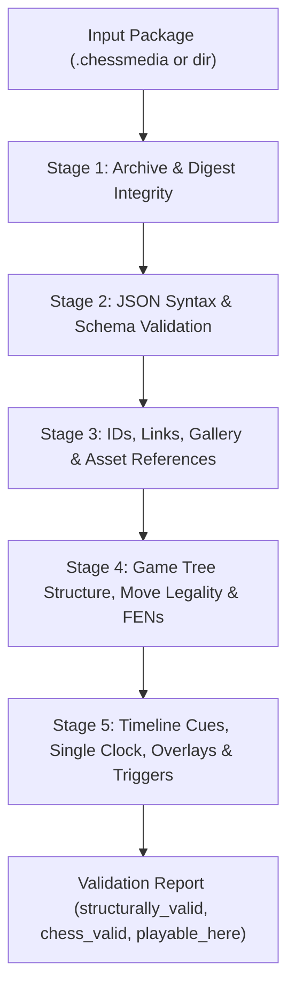

# ChessMedia 1.1 — Open Multimedia Chess Lesson Format Specification

Status: 1.1 Specification. Extension: `.chessmedia` (ZIP package) or unpacked directory.

The central contract of ChessMedia 1.1 is **deterministic presentation state at a single media presentation timestamp**. A player can seek directly to any millisecond `t_ms` and obtain the complete demo board(s), active game-tree node, variation context, board orientation, graphical overlays, captions, and position-keyed interactive triggers belonging to that moment. Demo boards inside a lesson own their state and never mutate or depend on the user's currently selected database row.

## Rationale: Legacy Problem → ChessMedia 1.1 Rule

| # | Legacy Failure Observed in Corpus (259 Fixtures) | Root Cause in Legacy Formats | ChessMedia 1.1 Rule |
|---|---|---|---|
| 1 | **Header & node-index opacity**: initial decoder recognised only 2/259 fixture videos (`result.tsv`; `sig.out`). | 3+ incompatible binary checkpoint header layouts (`5f900000...0bb803e803` with 3 time-control periods, `7e400000...` with 11 trailing zero bytes for an unused 3rd period, no time-control block `010000`, or a 78-byte inline board block `00...`), plus unlabeled recursive variation slots and promotion bits packed into square bytes (`from_sq >> 6`). | **Versioned, self-describing, schema-validated UTF-8 JSON.** Every file declares `version: {"major": 1, "minor": 1}` (or `schema_version: "1.1"`) and validates against formal JSON Schemas under `docs/chessmedia/schema/`. No binary offset probing or magic signatures. |
| 2 | **Variation tree guessing**: decoder had to pop a move stack until a `[from, to]` edge was legal, failing on 8/10 tournament lectures (`move applier failed: illegal or unresolvable edge`). | Moves were serialized as bare `[from, to]` file-major square numbers without parent references, resulting FENs, or explicit promotion piece symbols. | **Explicit `parent_id`, `uci`, and mandatory `fen` on every node.** Every node in `games/*.json` carries a stable `id`, explicit `parent_id` (`null` only on root), `uci` move, optional `san`, and complete 6-field resulting `fen`. Validators verify tree acyclicity, legal `uci` from `parent.fen`, and exact resulting `fen` equality. |
| 3 | **Set-position clips replayed from initial position**: tactical/endgame drills failed or desynchronized immediately. | Readers assumed the standard chess initial position unless a separate binary flag + 64-byte file-major occupancy array was decoded. | **Mandatory `start_fen` per game tree.** Every `games/*.json` file requires a top-level `start_fen` (and `setup` boolean), and the root node's `fen` MUST equal `start_fen`. Players never assume the standard starting position. |
| 4 | **Two clocks disagree**: sidecar `.txt` marks vs embedded container data-stream PTS appeared to drift by ~1.67× (`PART-C.md`: e.g. `7.5 / 13.5 / 15.7 s` vs `12.6 / 22.6 / 26.1 s`). | Container data streams drop or coalesce packets on keyframes and mix container send-time (`preroll`) with presentation time (`pts`), while sidecar exports record authoring-clock timestamps. | **One clock: media presentation time in milliseconds (`*_ms`) of a named asset track.** Every timeline binds to a single `clock_asset_id` and `clock_track` (`"presentation"`, `"audio"`, or `"video"`). Assets may declare an optional integer `offset_ms` (`effective_pts_ms = raw_pts_ms + offset_ms`). Send-time and wall-clock elapsed timers are forbidden. |
| 5 | **Wrong media-to-game pairing & shifting media lists**: videos paired with the wrong game and gallery lists changed per selected database row. | Legacy media catalogs coupled linkage to mutable database row numbers or byte offsets and omitted a deterministic gallery order. | **Stable IDs, composite game fingerprints, many-to-many `links`, and explicit `gallery_order`.** Every game has a stable `id` and a `fingerprint` (`header_hash` over normalized `white\|black\|event\|date\|round\|result` + `move_hash` over `start_fen` and main-line UCI moves). `manifest.json` declares explicit many-to-many `links` (`game_id`, `asset_id`, `timeline_id`) and a deterministic `gallery_order` array of `asset_id`s. |
| 6 | **Interactive clips & streams bolted on via filename hacks**: position-keyed drill clips encoded FENs with `z` separators and `x{from}y{to}v{V}u{U}` selectors in filenames; streams lacked first-class manifest metadata. | No structured representation for position-triggered branching or remote streaming endpoints. | **First-class `interactive_triggers` and `stream` assets.** Position-keyed triggers (`kind: "clip"` or `"range"`, optional move-keyed `branches`) bind directly to `fen` (`match_mode: "board_turn"` or `"exact"`) and/or `(game_id, node_id, at_ms)`. Stream assets (`kind: "stream"`) declare `uri` (`https://...`, e.g. HLS `.m3u8`), `media_type`, and `live` status. |
| 7 | **Silent synchronization failures**: corrupt or unsupported lessons left the board frozen at the starting position without warning. | Decoders swallowed parse errors and players lacked a sync-health state contract. | **Staged validator with machine-readable error codes (`E_*`) + mandatory player sync status.** `chessmedia validate` reports exact JSON pointers and error codes across 5 validation stages. Players must surface sync state (`synced`, `unsynced_*`, `error_*`) and the human-readable reason whenever synchronization is off or degraded. |
| 8 | **Incremental board event deltas broke on seek/rewind**: arrows, square marks, and comments accumulated or vanished when scrubbing. | Legacy streams mixed transient action opcodes with cumulative checkpoints. | **Full replacement scenes (`cues`) at integer `at_ms` timestamps.** Every cue in `timelines/*.json` stores the complete state of all declared boards (`game_id`, `node_id`, `orientation`, `overlays` with optional `end_ms`) and active `captions`. Seeking to any `t_ms` resolves in `O(log N)` via binary search without replaying intermediate deltas. |

---

## 1. Package and Ownership

A `.chessmedia` package is either a standard ZIP container (ZIP64 permitted for large video files) or an unpacked directory with identical relative paths. JSON files are encoded in UTF-8 without BOM. Already-compressed media assets (`.mp4`, `.webm`, `.mkv`, `.mp3`, `.ogg`, `.png`, `.jpg`) SHOULD use `ZIP_STORED` (compression method 0); JSON and text files MAY use `ZIP_DEFLATED` (compression method 8). No executable code is permitted in the package.

```text
lesson.chessmedia/
  manifest.json
  games/main.json
  timelines/main.json
  captions/en.vtt             optional WebVTT track
  assets/lecture.mp4          optional when using stream assets
  assets/drill-reply.mp4      optional interactive clip asset
  assets/poster.png           optional poster image
  provenance/import.json      optional legacy import provenance
```

### 1.1 Path Hygiene and Archive Safety
- All package paths MUST use forward slashes (`/`), be relative to the package root, and contain no leading `/`, drive prefix, empty segment, `.`, or `..`.
- Paths MUST be unique after Unicode NFC normalization and ASCII case folding.
- Readers and validators MUST reject archives containing duplicate entries, symbolic links, FIFOs, device nodes, more than 10,000 members, or uncompressed metadata JSON files exceeding 64 MiB.
- JSON parsers MUST reject duplicate object keys and non-finite numbers (`NaN`, `Infinity`, `-Infinity`).

### 1.2 Identifier Syntax
All object IDs (`id`, `board_id`, `game_id`, `node_id`, `asset_id`, `timeline_id`, `cue_id`, `trigger_id`) are case-sensitive ASCII strings matching:
```text
^[A-Za-z0-9][A-Za-z0-9._-]{0,127}$
```

---

## 2. Manifest (`manifest.json`)

Schema: [`docs/chessmedia/schema/manifest.schema.json`](chessmedia/schema/manifest.schema.json)

```json
{
  "format": "chessmedia",
  "version": {"major": 1, "minor": 1},
  "id": "biel-2015-r08-mvl-adams",
  "title": "Biel 2015 Round 08: Vachier-Lagrave vs Adams",
  "language": "en",
  "required_features": ["scene-timeline/1", "chess-standard/1"],
  "boards": [
    {"id": "demo", "title": "Demonstration Board"}
  ],
  "games": [
    {
      "id": "main",
      "path": "games/main.json",
      "fingerprint": {
        "header_hash": "a1b2c3d4e5f60718",
        "move_hash": "9f8e7d6c5b4a3210",
        "combined": "a1b2c3d4e5f60718:9f8e7d6c5b4a3210"
      }
    }
  ],
  "assets": [
    {
      "id": "video-main",
      "kind": "file",
      "path": "assets/lecture.mp4",
      "media_type": "video/mp4",
      "duration_ms": 600000,
      "offset_ms": 0,
      "clock_track": "presentation",
      "title": "Main Lecture Video"
    },
    {
      "id": "stream-hls",
      "kind": "stream",
      "uri": "https://media.example.org/lessons/biel-r08/master.m3u8",
      "media_type": "application/vnd.apple.mpegurl",
      "duration_ms": 600000,
      "offset_ms": 0,
      "clock_track": "presentation",
      "live": false,
      "title": "HLS Adaptive Stream"
    }
  ],
  "timelines": [
    {
      "id": "lecture",
      "path": "timelines/main.json",
      "clock_asset_id": "video-main"
    }
  ],
  "links": [
    {
      "game_id": "main",
      "asset_id": "video-main",
      "timeline_id": "lecture",
      "role": "primary"
    },
    {
      "game_id": "main",
      "asset_id": "stream-hls",
      "timeline_id": "lecture",
      "role": "alternate-stream"
    }
  ],
  "gallery_order": ["video-main", "stream-hls"],
  "primary": {
    "timeline_id": "lecture",
    "asset_id": "video-main"
  },
  "provenance": {
    "path": "provenance/import.json"
  },
  "members": [
    {
      "path": "games/main.json",
      "bytes": 1842,
      "sha256": "e3b0c44298fc1c149afbf4c8996fb92427ae41e4649b934ca495991b7852b855"
    }
  ]
}
```

### 2.1 Ownership, Fingerprints, Links, and Gallery Order
- **Game Fingerprints**: Every game has an explicit `id` and a `fingerprint` computed from both its metadata and its moves:
  1. `header_hash`: 16-character lowercase hexadecimal FNV-1a-64 digest of the UTF-8 string `"white|black|event|date|round|result"` where each field is ASCII-lowercased and whitespace-trimmed.
  2. `move_hash`: first 16 lowercase hexadecimal characters of the SHA-256 digest of `"<start_fen>|<uci_1> <uci_2> ... <uci_n>"` along the game's `main_child_id` path from the root node.
  3. `combined`: `"<header_hash>:<move_hash>"`.
  The manifest `games[]` entry MUST mirror the `fingerprint` declared in the corresponding `games/*.json` file.
- **Many-to-Many `links`**: `links` explicitly binds `game_id` to `asset_id` (and optional `timeline_id` and `role` in `{"primary", "alternate-stream", "interactive-clip", "commentary", "supplemental"}`). A single game can own multiple media assets (e.g., main lecture + interactive clips + stream fallback), and a single multi-game report video can link to multiple `game_id`s.
- **Deterministic `gallery_order`**: `gallery_order` is an ordered list of unique `asset_id`s defining the package's media gallery order. A player's gallery view MUST follow `gallery_order` and MUST NOT reorder or drop package assets when the user selects different games in a database.
- **Member Digests (`members`)**: Every file inside the package except `manifest.json` itself MUST appear in `members` with its exact uncompressed `bytes` count and 64-character lowercase hex `sha256`. Stream assets (`kind: "stream"`) without a local file are not package files and do not appear in `members`.

---

## 3. Game Trees (`games/*.json`)

Schema: [`docs/chessmedia/schema/game.schema.json`](chessmedia/schema/game.schema.json)

```json
{
  "schema_version": "1.1",
  "id": "main",
  "variant": "standard",
  "fen_encoding": "fen",
  "start_fen": "rnbqkbnr/pppppppp/8/8/8/8/PPPPPPPP/RNBQKBNR w KQkq - 0 1",
  "setup": false,
  "tags": {
    "Event": "48th Biel GM 2015",
    "Site": "Biel SUI",
    "Date": "2015.07.28",
    "Round": "8",
    "White": "Vachier-Lagrave, Maxime",
    "Black": "Adams, Michael",
    "Result": "1-0"
  },
  "fingerprint": {
    "header_hash": "58d218733610824a",
    "move_hash": "4a1e9c02b7f38d11",
    "combined": "58d218733610824a:4a1e9c02b7f38d11"
  },
  "nodes": [
    {
      "id": "n0",
      "parent_id": null,
      "uci": null,
      "san": null,
      "fen": "rnbqkbnr/pppppppp/8/8/8/8/PPPPPPPP/RNBQKBNR w KQkq - 0 1",
      "main_child_id": "n1"
    },
    {
      "id": "n1",
      "parent_id": "n0",
      "uci": "e2e4",
      "san": "e4",
      "fen": "rnbqkbnr/pppppppp/8/8/4P3/8/PPPP1PPP/RNBQKBNR b KQkq - 0 1",
      "main_child_id": "n2"
    },
    {
      "id": "n2",
      "parent_id": "n1",
      "uci": "e7e5",
      "san": "e5",
      "fen": "rnbqkbnr/pppp1ppp/8/4p3/4P3/8/PPPP1PPP/RNBQKBNR w KQkq - 0 2",
      "main_child_id": null
    },
    {
      "id": "n2_var1",
      "parent_id": "n1",
      "uci": "c7c5",
      "san": "c5",
      "fen": "rnbqkbnr/pp1ppppp/8/2p5/4P3/8/PPPP1PPP/RNBQKBNR w KQkq - 0 2",
      "main_child_id": null
    }
  ]
}
```

### 3.1 Game Tree Rules
1. **Mandatory `start_fen`**: Every game object MUST include `start_fen` (a valid 6-field FEN). When `start_fen` differs from the variant's initial array, `setup` MUST be `true`.
2. **Root Node**: Exactly one node in `nodes` MUST have `parent_id: null`. Its `uci` and `san` MUST be `null`, and its `fen` MUST equal `start_fen`.
3. **Explicit Parent/Child Links**: Every non-root node MUST specify `parent_id` referencing an existing node `id` in the same game, a non-empty `uci` move string, and its resulting 6-field `fen`. The node graph MUST be a single connected directed tree rooted at the root node (no cycles, no orphan subtrees).
4. **Move Legality and FEN Verification**:
   - In `standard` chess, `uci` uses standard UCI coordinate notation (`e2e4`, `e7e8q`, castling as king-to-destination `e1g1`/`e1c1`/`e8g8`/`e8c8`).
   - In `chess960`, `fen_encoding` is `"shredder-fen"` (or `"xfen"`) and `uci` castling uses king-captures-own-rook notation.
   - Applying `node.uci` to `parent.fen` MUST be a legal move and MUST produce a position matching `node.fen` across all 6 FEN fields (piece placement, active color, castling availability, en-passant target square, halfmove clock, and fullmove number; for en-passant, standard FEN and X-FEN legal-ep conventions are accepted if consistent).
   - If `node.san` is non-null, it MUST match the canonical SAN of `node.uci` in `parent.fen`.

---

## 4. Timelines, Full Scenes, and Single-Clock Contract (`timelines/*.json`)

Schema: [`docs/chessmedia/schema/timeline.schema.json`](chessmedia/schema/timeline.schema.json)

```json
{
  "schema_version": "1.1",
  "id": "lecture",
  "clock_asset_id": "video-main",
  "clock_track": "presentation",
  "duration_ms": 600000,
  "cues": [
    {
      "id": "cue-0000",
      "at_ms": 0,
      "scene": {
        "boards": {
          "demo": {
            "game_id": "main",
            "node_id": "n0",
            "orientation": "white",
            "overlays": []
          }
        },
        "captions": []
      }
    },
    {
      "id": "cue-0001",
      "at_ms": 12500,
      "scene": {
        "boards": {
          "demo": {
            "game_id": "main",
            "node_id": "n1",
            "orientation": "white",
            "overlays": [
              {
                "id": "ov-arrow-1",
                "kind": "arrow",
                "from": "e2",
                "to": "e4",
                "color": "#33aa55ff",
                "end_ms": 15000
              },
              {
                "id": "ov-sq-1",
                "kind": "square",
                "square": "e4",
                "color": "#33aa5580"
              }
            ]
          }
        },
        "captions": [
          {
            "lang": "en",
            "placement": "post",
            "text": "White opens with 1.e4, controlling d5 and f5.",
            "end_ms": 18000
          }
        ]
      }
    }
  ],
  "chapters": [
    {"id": "ch-1", "title": "Opening", "at_ms": 0}
  ],
  "interactive_triggers": []
}
```

### 4.1 Single-Clock Contract
- All timestamps (`duration_ms`, `at_ms`, `end_ms`, `start_ms`, `offset_ms`) are integer milliseconds (`0 <= t <= 9007199254740991`,except `offset_ms` which may be signed integer ms).
- A timeline's master clock is the media presentation timestamp (`pts`) of `clock_asset_id` on `clock_track` (`"presentation"`, `"audio"`, or `"video"`), normalized to container presentation origin `0` and shifted by the asset's `offset_ms`:
  ```text
  timeline_ms = asset_pts_ms + asset.offset_ms
  ```
- Container packet send-time (`dts`/preroll send timestamps) and wall-clock timers elapsed since pressing Play MUST NOT be used as the timeline clock.

### 4.2 Full Scene Evaluation (`scene_at`)
- `cues` MUST be non-empty, start with `cues[0].at_ms == 0`, have strictly increasing `at_ms` (`cues[i].at_ms > cues[i-1].at_ms`), and satisfy `cues[i].at_ms <= duration_ms`.
- Every cue's `scene.boards` object MUST include an entry for every board `id` declared in `manifest.boards`. Each board state is either `{"hidden": true}` or a complete state `{ "game_id": ..., "node_id": ..., "orientation": "white"|"black", "overlays": [...] }`.
- Overlays start at `cue.at_ms` and expire at `overlay.end_ms` (if specified, where `cue.at_ms < overlay.end_ms <= duration_ms`) or at the next cue's `at_ms`, whichever comes first (half-open interval `[at_ms, min(end_ms, next_cue_at_ms))`).
- Overlay kinds:
  - `"arrow"`: requires `from` and `to` (`a1`–`h8`), `color` (`#RRGGBBAA`).
  - `"square"`: requires `square` (`a1`–`h8`), `color` (`#RRGGBBAA`).
  - `"label"`: requires `square` (`a1`–`h8`), `text` (non-empty UTF-8 string, max 64 chars), `color` (`#RRGGBBAA`).
- Scene captions in `scene.captions` are self-contained timeline annotations (`lang`, `text`, optional `placement` in `{"pre", "post", "subtitle"}`, optional `end_ms` with half-open interval `[at_ms, min(end_ms, next_cue_at_ms))`).
- Given any target time `0 <= t_ms <= duration_ms`, `scene_at(timeline, t_ms)` selects the latest cue `c` with `c.at_ms <= t_ms` via `O(log N)` binary search and filters out overlays and captions whose `end_ms <= t_ms`.

---

## 5. Interactive Clips and Streams

### 5.1 Position-Keyed Interactive Triggers (`interactive_triggers`)
Interactive lessons (such as position-triggered video clips, time-range segments, or move-keyed tactical drills) are represented as `interactive_triggers` in `timelines/*.json` (or package-wide in `manifest.json`):

```json
{
  "id": "trig-mar-del-plata-q1",
  "fen": "r1bq2k1/ppp2r2/3p1n1b/2PPp1pp/4Pn2/2NNBPR1/PP2B2P/2RQ3K w - - 0 1",
  "match_mode": "board_turn",
  "game_id": "main",
  "node_id": "n124",
  "at_ms": 416460,
  "kind": "clip",
  "asset_id": "clip-prompt",
  "prompt": "Find White's best continuation.",
  "branches": [
    {
      "id": "branch-primary",
      "uci": "d1b3",
      "san": "Qb3",
      "role": "primary",
      "asset_id": "clip-qb3",
      "overlay_arrow": {"from": "d1", "to": "b3"}
    },
    {
      "id": "branch-alt-1",
      "uci": "e2f1",
      "san": "Bf1",
      "role": "alternative",
      "asset_id": "clip-bf1",
      "overlay_arrow": {"from": "e2", "to": "f1"}
    }
  ]
}
```

Rules for `interactive_triggers`:
1. `fen` MUST be a valid 6-field FEN. `match_mode` is `"board_turn"` (default: matches piece placement + side to move, ignoring castling/ep/clocks so transpositions match) or `"exact"` (matches all 6 FEN fields).
2. If `game_id` and `node_id` are specified, `node_id` MUST exist in `game_id` and its FEN MUST match `trigger.fen` under `match_mode`.
3. `kind` is one of:
   - `"clip"`: plays `asset_id` (and optional `timeline_id`) from the beginning.
   - `"range"`: plays `asset_id` over `[start_ms, end_ms]` where `0 <= start_ms < end_ms <= asset.duration_ms`.
   - `"branch_prompt"`: pauses or plays optional prompt `asset_id` when reached (`at_ms` or position match), then dispatches to one of `branches` when the learner plays a move on the board.
4. Every entry in `branches` MUST have a `uci` move that is **strictly legal** in `trigger.fen` (and matching `san` if provided), a `role` (`"primary"` or `"alternative"`), and a valid target `asset_id` (plus `start_ms`/`end_ms` if `range`).

### 5.2 Stream Assets (`kind: "stream"`)
Stream assets are first-class citizens in `manifest.assets`:
- `kind`: `"stream"`
- `uri`: MUST be a valid `https://` (or `http://`) URI (e.g. `https://.../master.m3u8` with `media_type: "application/vnd.apple.mpegurl"`, DASH `application/dash+xml`, or progressive `video/mp4` / `video/webm`).
- `live`: boolean (`false` for VOD streams synchronized to a fixed timeline; `true` for live streams).
- `duration_ms`: required nonnegative integer for VOD streams (`live: false`).
- `fallback_path`: optional package-relative file path for offline playback; if present, `fallback_path` MUST be listed in `manifest.members`.

---

## 6. Validation Stages, Error Codes, and Player Sync Contract



### 6.1 Validator Error Codes
A conforming validator MUST report errors with the following machine-readable codes and exact JSON pointer / file paths:

| Stage | Error Code | Condition |
|---|---|---|
| 1 (Archive) | `E_ARCHIVE_UNSAFE_PATH` | Path contains `..`, leading `/`, backslash, symlink, or case-folding collision |
| 1 (Archive) | `E_MANIFEST_MISSING` | `manifest.json` does not exist at package root |
| 1 (Archive) | `E_MEMBER_MISSING` | File listed in `manifest.members` or referenced by path is missing from package |
| 1 (Archive) | `E_MEMBER_UNLISTED` | Package file (other than `manifest.json`) is omitted from `manifest.members` |
| 1 (Archive) | `E_MEMBER_HASH_MISMATCH` | File byte length or SHA-256 does not match `manifest.members` |
| 2 (Schema) | `E_JSON_SYNTAX` | Malformed UTF-8 JSON, duplicate object key, or non-finite number |
| 2 (Schema) | `E_SCHEMA_VIOLATION` | Missing required field, wrong type, or invalid enum/pattern per JSON Schema |
| 2 (Schema) | `E_UNSUPPORTED_VERSION` | `format != "chessmedia"` or `version.major != 1` |
| 2 (Schema) | `E_UNSUPPORTED_FEATURE` | Unknown entry in `required_features` |
| 3 (Refs) | `E_DUPLICATE_ID` | Duplicate ID within `boards`, `games`, `assets`, `timelines`, `nodes`, `cues`, or `triggers` |
| 3 (Refs) | `E_REF_UNKNOWN` | Reference to unknown `board_id`, `game_id`, `node_id`, `asset_id`, or `timeline_id` |
| 3 (Refs) | `E_GALLERY_INVALID` | `gallery_order` references an unknown `asset_id` or contains duplicates |
| 3 (Refs) | `E_STREAM_URI_INVALID` | Stream asset `uri` is missing or does not use `https://` / `http://` |
| 4 (Chess) | `E_START_FEN_INVALID` | Missing or illegal `start_fen`, or `root.fen != start_fen` |
| 4 (Chess) | `E_TREE_STRUCTURE` | Zero or multiple roots, dangling `parent_id`, cycle, unreachable node, or invalid `main_child_id` |
| 4 (Chess) | `E_ILLEGAL_MOVE` | Node `uci` is not a legal move from `parent.fen` under `variant` |
| 4 (Chess) | `E_FEN_MISMATCH` | Applying `node.uci` to `parent.fen` does not yield `node.fen` |
| 4 (Chess) | `E_SAN_MISMATCH` | Node `san` does not match the canonical SAN of `node.uci` from `parent.fen` |
| 4 (Chess) | `E_FINGERPRINT_MISMATCH` | Game or manifest `fingerprint` does not match computed `header_hash` / `move_hash` |
| 5 (Timeline) | `E_CUE_ZERO_MISSING` | `cues` is empty or `cues[0].at_ms != 0` |
| 5 (Timeline) | `E_CUE_ORDER` | Cue timestamps `at_ms` are not strictly increasing (`cues[i].at_ms <= cues[i-1].at_ms`) |
| 5 (Timeline) | `E_CUE_PAST_DURATION` | `cue.at_ms > timeline.duration_ms` or `overlay.end_ms > timeline.duration_ms` |
| 5 (Timeline) | `E_SCENE_INCOMPLETE` | `cue.scene.boards` is missing a declared board ID or contains an undeclared board ID |
| 5 (Timeline) | `E_OVERLAY_INVALID` | Invalid square (`a1`–`h8`), color (`#RRGGBBAA`), or `end_ms <= at_ms` |
| 5 (Timeline) | `E_TRIGGER_INVALID` | Invalid trigger `fen`, illegal branch `uci` in `trigger.fen`, or invalid `start_ms`/`end_ms` range |

### 6.2 Player Synchronization & Diagnostic Surface Contract
A conforming player MUST maintain and display an explicit synchronization status:
- `synced`: Master presentation clock is advancing and scenes are applied within target latency (≤ 75 ms local qualification target).
- `unsynced_manual_preview`: User manually navigated the demo board away from the active video scene; player MUST offer a one-click "Follow video" action to return to the current scene without mutating any database game.
- `unsynced_no_timeline`: Media asset has no associated timeline (pure video/audio asset); player MUST display `"Unsynchronized media (no board timeline)"`.
- `unsynced_incomplete_import`: Current time interval falls in a region flagged as `incomplete` in `provenance/import.json`; player MUST surface the provenance warning.
- `unsynced_clock_stalled`: Media backend has not reported a fresh presentation timestamp within the uncertainty bound (100 ms max extrapolation).
- `error_validation_failed`: Package failed validation; player MUST surface the validator error code(s) and message(s).

---

## 7. Legacy Import Without Fabricated Precision (`provenance/import.json`)

Schema: [`docs/chessmedia/schema/provenance.schema.json`](chessmedia/schema/provenance.schema.json)

When importing legacy multimedia lessons (`.wmv` script streams, `.txt` command sidecars, `.cms` interactive hotspot indexes, and companion `.pgn` files):
1. **No Fabricated Precision**: Never invent frame-accurate move timestamps by dividing video duration by ply count. Never relabel an unresolvable cursor as a main-line ply.
2. **Explicit Inferred Markers**: Every value that required inference or disambiguation MUST be recorded in `provenance/import.json` (and marked with `"inferred": true` on the node or cue when applicable):
   - **Clock source selection**: When both a `.txt` sidecar and an embedded `.wmv` script stream exist and their timestamps differ, `provenance/import.json` records `clock_source` (`"sidecar_txt"`, `"wmv_pts"`, or `"checkpoint_type37"`), the measured discrepancy (`clock_drift_stats`), and why the authoritative clock was chosen.
   - **Set-position start FEN**: Whether `start_fen` came from an explicit PGN `[FEN]` tag, a `.cms` chapter record, a filename selector, or a decoded 64-byte checkpoint board array.
   - **Promotion piece**: When a legacy edge encodes a promotion without an explicit non-queen flag (or defaults to queen), mark the node `"inferred": true` with `"inferred_fields": ["uci_promotion"]`.
   - **Multi-game or partial epochs**: When a legacy stream switches games mid-video or contains checkpoints with 0 moves (pure video lectures), record each game epoch and confidence level (`"high"`, `"medium"`, `"low"`, or `"unsynchronized_media_only"`).
