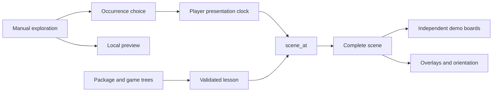

# ChessMedia 1.0 — proposed lesson format

Status: design draft, not an implemented Scidb import format. Proposed extension:
`.chessmedia`. An unpacked directory has the same logical contents as the package.

The central contract is **presentation state at a media timestamp**. A player can
seek directly to any moment and obtain the complete demo board, variation,
arrows, orientation and captions belonging to that moment. A lesson's demo
boards have their own state; they do not navigate or modify the user's database
game to imitate the lecturer.

This proposal addresses the limitations observed in Scidb's current ChessBase
import path: opaque authoring-node indexes, incomplete reconstruction of
variation positions, and synchronization delegated to the currently selected
game. It does not claim to describe every ChessBase format or product version.

## 1. Package and ownership

Use a ZIP container, with ZIP64 permitted for large videos. JSON is UTF-8. Store
already-compressed media without additional ZIP compression; metadata may use
Deflate. No executable code is part of the core format.

```text
lesson.chessmedia
  manifest.json
  games/main.json
  timelines/main.json
  captions/en.vtt             optional feature
  assets/lecture.mp4
  assets/poster.png           optional
  provenance/import.json     optional
```

The package owns its game trees and media; a Scidb database can link to the
package by package ID without becoming a prerequisite for playback. Moving the
package preserves every reference. The directory representation supports
editing and source control. HTTP distribution can serve the unpacked directory;
remote loading is an optional capability, not required for offline playback.

Use ordinary package-relative paths. Paths must be unique after Unicode NFC
normalization and case folding, use `/`, and contain no absolute prefix, empty
segment, `.` or `..`. Reject duplicate ZIP entries and symlink members. Readers
bound member counts, uncompressed bytes and nesting; they never execute imported
HTML, shell snippets or source scripts.

## 2. Manifest

```json
{
  "format": "chessmedia",
  "version": {"major": 1, "minor": 0},
  "id": "lesson-e4-demo",
  "title": "A move, a variation, and a return",
  "language": "en",
  "required_features": ["scene-timeline/1", "chess-standard/1"],
  "boards": [{"id": "demo", "title": "Demonstration"}],
  "games": [{"id": "main", "path": "games/main.json"}],
  "timelines": [{"id": "lecture", "path": "timelines/main.json"}],
  "assets": [{
    "id": "video", "path": "assets/lecture.mp4",
    "media_type": "video/mp4", "duration_us": 6000000
  }],
  "primary": {"timeline_id": "lecture", "asset_id": "video"},
  "members": [{
    "path": "games/main.json", "bytes": 1234,
    "sha256": "<64 lowercase hexadecimal digits>"
  }]
}
```

The digest and size above are illustrative, not a valid example member. A
conforming writer must calculate real values for every member.

`members` covers every file except `manifest.json` itself, exactly once. Digests
use SHA-256 over uncompressed file bytes. They detect damage and accidental
asset substitution; they do not authenticate an author. A package ID identifies
the editorial work, not its bytes. External catalogs can identify a particular
revision by hashing the complete manifest bytes.

IDs are stable, opaque, case-sensitive ASCII strings matching
`[A-Za-z0-9][A-Za-z0-9._-]{0,127}`; authors must not reuse IDs for different
objects within an editorial work. Required references resolve inside the
package. Unknown required features prevent synchronized playback; unknown
optional namespaced metadata is preserved on round-trip.

The core is codec-neutral. An asset declares its media type and optional codec
information; the reader checks backend support before starting. Producers may
bundle alternative encodings of the same timeline with identical presentation
origin and duration. A future browser profile can require a particular codec
set without changing the chess or timeline representation.

## 3. Game trees: identity survives variations and repetition

A game file contains `id`, `variant`, `fen_encoding`, `tags`, and `nodes`.
Core variant profiles are `standard` with ordinary FEN and `chess960` with
Shredder-FEN castling rights. Unsupported variants are explicit required
features, rather than silently interpreted as standard chess.

Each tree has exactly one root node with `parent_id: null`, a complete initial
FEN, and no move. Every other node has one parent, a UCI move and its complete
resulting FEN. Nodes may be stored in any order; the tree must be acyclic and all
nodes must be reachable from its root. Main-line preference is an explicit
`main_child_id` on the parent. SAN, when supplied, is a derived display cache.

For standard chess UCI castling uses king-to-destination notation. For Chess960
it uses king-to-rook notation, explicitly declared by the variant profile.
Promotions use a lowercase UCI promotion suffix. Readers verify legal moves and
resulting FENs before marking the lesson valid.

```json
{
  "id": "main", "variant": "standard", "fen_encoding": "fen",
  "tags": {"White": "White", "Black": "Black", "Result": "*"},
  "nodes": [
    {"id": "root", "parent_id": null,
     "fen": "rnbqkbnr/pppppppp/8/8/8/8/PPPPPPPP/RNBQKBNR w KQkq - 0 1",
     "main_child_id": "e4"},
    {"id": "e4", "parent_id": "root", "uci": "e2e4", "san": "e4",
     "fen": "rnbqkbnr/pppppppp/8/8/4P3/8/PPPP1PPP/RNBQKBNR b KQkq - 0 1"},
    {"id": "d4", "parent_id": "root", "uci": "d2d4", "san": "d4",
     "fen": "rnbqkbnr/pppppppp/8/8/3P4/8/PPP1PPPP/RNBQKBNR b KQkq - 0 1"}
  ]
}
```

Repeated or transposed positions retain distinct node IDs when their histories
differ. FEN hashes may accelerate comparison, but are never node identity. A
demo board can switch to a different game tree for a new setup without replacing
any database game. Arbitrary illegal diagrams are outside the initial core
profile; a future diagram profile must declare their reduced semantics.

## 4. Timeline: full scenes, exact times

A timeline file has `id`, `duration_us`, `cues`, and optional `chapters`.
All time values are nonnegative integer microseconds, bounded to `2^53-1` for
JSON interoperability. Timestamp zero means the beginning of the asset's
presented content, after the adapter normalizes any nonzero container PTS
origin. Playback rate changes how quickly timestamps advance; it does not
multiply timestamps a second time.

Cue timestamps are strictly increasing. Exactly one complete scene is stored
at each timestamp, including a required cue at zero. A scene includes every
board declared by the manifest, either a visible board reference or
`{"hidden": true}`. A visible board has `game_id`, `node_id`, `orientation`, and
an `overlays` array. Scenes are complete replacements, never incremental
commands such as “advance twice” or “clear the previous arrow”.

```json
{
  "id": "lecture", "duration_us": 6000000,
  "cues": [
    {"id": "intro", "at_us": 0,
     "scene": {"boards": {"demo": {
       "game_id": "main", "node_id": "root",
       "orientation": "white", "overlays": []
     }}}},
    {"id": "show-e4", "at_us": 1000000,
     "scene": {"boards": {"demo": {
       "game_id": "main", "node_id": "e4",
       "orientation": "white", "overlays": [
         {"id": "center-arrow", "kind": "arrow", "from": "e2", "to": "e4",
          "color": "#33aa55ff", "end_us": 1800000}
       ]
     }}}},
    {"id": "show-alternative", "at_us": 3000000,
     "scene": {"boards": {"demo": {
       "game_id": "main", "node_id": "d4",
       "orientation": "white", "overlays": []
     }}}},
    {"id": "return-to-e4", "at_us": 4000000,
     "scene": {"boards": {"demo": {
       "game_id": "main", "node_id": "e4",
       "orientation": "white", "overlays": []
     }}}}
  ],
  "chapters": [{"id": "opening", "title": "First moves", "at_us": 0}]
}
```

An overlay starts with its scene and ends at `end_us` or the next scene,
whichever comes first. The interval is half-open. Core overlay kinds are
`arrow` (`from`, `to`), `square` (`square`), and `label` (`square`, `text`).
Squares use algebraic names `a1`–`h8`; color uses `#RRGGBBAA`; label text is
plain UTF-8. Orientation changes rendering, not square meaning. Replacement
scenes and time-based expiry make rewind and skipped frames deterministic.

The visible state at time `t` is the latest cue with `at_us <= t`, with expired
overlays removed. At a cue boundary the new scene wins. At media end retain the
last scene. Seeking to 3.5 seconds displays the d4 variation directly; seeking
to 4.5 seconds displays e4 again. Neither operation replays intermediate moves.
A binary search finds the scene in O(log N); rendering touches only its boards
and visible overlays. Full scenes favor correctness and inspectability over a
small metadata saving from deltas; the video normally dominates package size.

## 5. Captions and educational extensions

Captions are an optional declared `webvtt/1` feature with asset references and
language tags. A reader can play the core scene timeline without captions.
Alternative narration tracks must share the timeline's presentation origin or
declare a supported mapping feature.

Quizzes, branching lessons, analysis snapshots and hotspots are useful later
profiles. Their names and capabilities are reserved through namespaced
extensions, but their wire semantics are not specified by this draft. Do not
ship essential quiz behavior as an optional extension, nor embed arbitrary
scripts to implement it. Ordinary chapter navigation is already in the core.

## 6. Player contract: latency is measured separately

A good file cannot repair a stalled player clock. The playback adapter reports:

```text
ClockSample(session_id, media_us, sampled_monotonic_us,
            rate, state, uncertainty_us, seek_generation)
```

`media_us` is nullable when unknown; unknown never means zero. `state` is one
of loading, playing, paused, buffering, seeking, ended or error. Sampling age
and uncertainty are diagnostic data. Audio/video presentation time is the
master clock; a Tk timer or wall-clock elapsed since pressing Play is not.

During ordinary playback, evaluate the scene at the latest valid presentation
time. Hold the last state through buffering, missing samples and temporary
startup states, and keep monitoring until the session is closed. On speed
changes, prefer fresh samples. Any monotonic extrapolation is bounded by the
adapter's declared uncertainty and a maximum of 100 ms; do not invent seconds
of progress when a backend stops reporting.

On seek, increment the session's seek generation, request the transport seek,
and apply the scene at the **confirmed actual** media position. Older command
responses and samples cannot overwrite the newer seek. A requested position may
be shown as a UI preview, clearly separate from confirmed playback state. A
backend that lands on a nearby keyframe reports that actual position; scene
selection uses it rather than an invented successful target time.

The renderer applies board, orientation and overlays as one scene update.
Every programmatic update carries an origin token, so it cannot trigger a
reverse board-to-video seek. Manual exploration creates a local preview; “follow
video” returns to the current scene without editing the saved game.

Board-to-video navigation uses `(game_id, node_id, cue_id)` occurrences, not a
FEN lookup. When the same move is discussed at 1 and 4 seconds, prefer the
occurrence nearest the current media time; ties choose the earlier occurrence.
An occurrence picker lets the learner choose another explanation. A node with
no occurrence has no implied video timestamp.

Target for a capable local player: displayed board within 75 ms of the authored
cue at normal speed, or within one frame plus reported clock uncertainty,
whichever is larger. This is a player qualification target, not a promise made
by the container. Record clock age, control round-trip time, renderer duration
and measured drift independently. Hardware-specific latency compensation is a
player setting; an authoring timestamp correction belongs in the timeline.

## 7. A small implementation interface

```text
open(package) -> validated Lesson
scene_at(lesson, timeline_id, time_us) -> immutable Scene
occurrences(lesson, timeline_id, game_id, node_id) -> cue references
close(lesson)
```

Parsing, reference resolution, variant validation, overlay expiry and seek
indexing stay inside this module. The player adapter handles transport and
clock sampling. The renderer handles independent demo boards. Tests call the
same `scene_at` interface used by playback.



## 8. Validation and compatibility

Validate in stages: bounded archive and member hashes; JSON and version;
references and tree structure; legal moves and FENs; timeline and overlay
constraints; playable media and presentation origin. A result separates
`structurally_valid`, `chess_valid` and `playable_here`, so missing codecs do not
masquerade as corrupt chess data.

Reject duplicate JSON keys, nonfinite numbers, dangling nodes, illegal moves,
incorrect cached SAN/FEN, negative or oversized times, cues past duration,
missing initial scenes, unknown board IDs and incomplete scenes. FEN comparison
must follow the declared variant, including side, castling, en-passant state and
counters; validators cannot compare only board occupancy.

A major version changes core semantics. A minor version adds optional metadata
or capability profiles. Unknown required capabilities fail explicitly. Preserve
unknown optional metadata on round-trip. A player may still offer unsynchronized
media viewing, labelled accordingly, when synchronized playback is unavailable.

## 9. Legacy import without fabricated precision

Convert existing `.scm/.smv`, ChessBase media links, script streams and text
sidecars into this model. Keep original files when redistribution rights allow;
record importer/version, input digests, source timestamps, decode warnings and
per-cue provenance.

Map source nodes to stable game/node IDs and complete FENs. Unresolved variation
nodes remain unresolved: omit the unsupported cue, keep the last known scene,
and mark the imported interval as incomplete in provenance. Never relabel an
opaque source node as a main-line ply, stretch moves proportionally across a
video, or claim frame-accurate synchronization from guessed timings. Source
annotation deltas are materialized into full scenes during import.

The existing Scidb lesson cache can become an import cache. Cache keys include
all source hashes plus importer/version and projection policy. The original
legacy data remains available for improved future conversion.

## 10. Delivery sequence and acceptance tests

1. Publish the draft, example package and validation fixtures; stabilize
   standard/chess960 tree and full-scene semantics.
2. Implement a strict validator and pure scene evaluator. Export PGN from game
   trees; include a loss report when exporting lessons to PGN alone.
3. Add independent demo-board rendering and a playback-session clock adapter.
   Keep existing database editing and lesson playback separate.
4. Add a legacy converter with explicit completeness reporting.
5. Add authoring: record moves/arrows against presentation timestamps, scrub to
   edit a scene, then export an immutable package.
6. Add caption/browser/quiz profiles after the core interoperates across two
   independent readers.

Required fixture cases: forward playback, seek before the first move, backward
seek, repeated node occurrences, transpositions, two simultaneous boards,
variation-to-main-line return, a changed starting position, Chess960 castling,
promotion, en passant, overlay expiry while paused, loading/buffering recovery,
missing clock samples, reordered seek acknowledgments, playback-rate changes,
codec failure and an incomplete legacy import.

## References

- [RFC 8259](https://www.rfc-editor.org/rfc/rfc8259): JSON and interoperable
  integer bounds. This draft deliberately keeps times inside those bounds.
- [mpv reference manual](https://mpv.io/manual/stable/): IPC property observation,
  playback properties and seek behavior. These motivate a clock adapter; the
  format itself is independent of mpv.
- Local reverse-engineering and implementation context:
  [media panel design](MEDIA_PANEL_DESIGN.md),
  [lesson reconstruction plan](../MEDIA_LESSON_V2_PLAN.md),
  [native companion format](../SCM_FORMAT_DESIGN.md).
